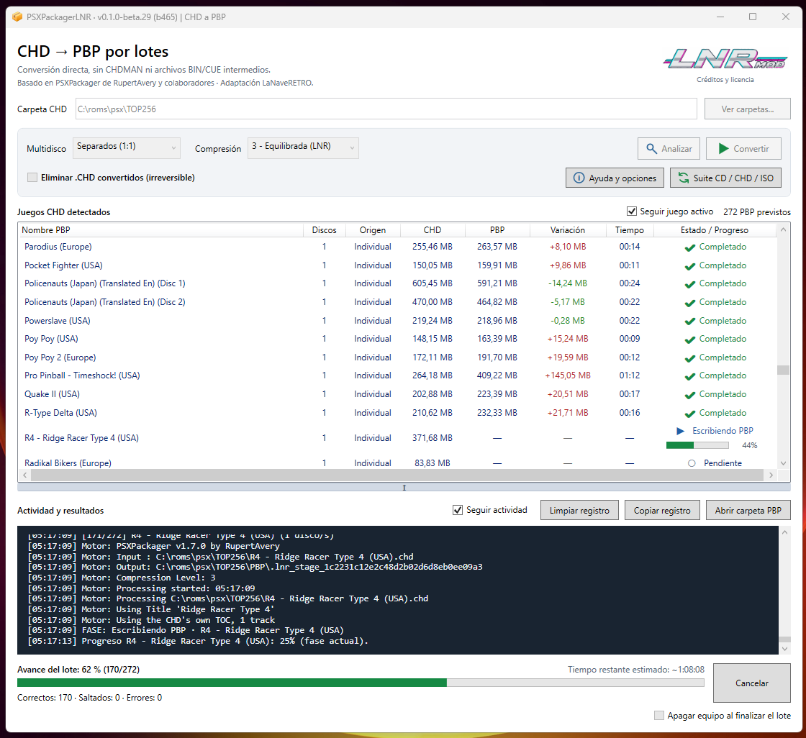
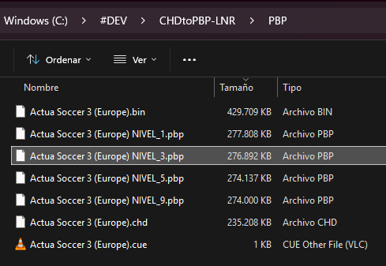

# PSXPackagerLNR — LaNaveRETRO Edition

**Convierte colecciones de PlayStation 1 de CHD a PBP directamente, por lotes, con una interfaz gráfica portátil para Windows.** Incluye conversiones simultáneas, pausa segura, organización multidisco y una Suite de Discos para PS1, Saturn, PS2 y Dreamcast.

> **Fork independiente de [PSXPackager de RupertAvery y colaboradores](https://github.com/RupertAvery/PSXPackager).** El motor original, su autoría y su licencia MIT se respetan. **PaPer-DJ / LaNaveRETRO** ha desarrollado las herramientas, automatizaciones y mejoras de la edición LNR. El proyecto original no se modifica.

**Versión pública más reciente: [v1.0.0 — release estable del fork](https://github.com/PaPer-DJ/PSXPackagerLNR/releases/tag/v1.0.0)** · Windows x64 · .NET 8 autocontenido · Sin instalador.

## Descargar

| Edición | Para qué sirve | Descarga |
|---|---|---|
| **GUI — recomendada** | Interfaz CHD → PBP, procesamiento por lotes y Suite de Discos. Incluye el motor CLI y el acceso directo portátil. | [**GUI v1.0.0 (ZIP)**](https://github.com/PaPer-DJ/PSXPackagerLNR/releases/download/v1.0.0/PSXPackagerLNR-v1.0.0-b786-GUI-win-x64.zip) |
| **Toolkit** | Menú BAT/PowerShell para convertir lotes CHD → PBP desde la consola, sin abrir la GUI. | [Toolkit v1.0.0 (ZIP)](https://github.com/PaPer-DJ/PSXPackagerLNR/releases/download/v1.0.0/PSXPackagerLNR-v1.0.0-b786-Toolkit-win-x64.zip) |
| **CLI** | Motor de PSXPackager por línea de comandos con los ajustes específicos LNR. | [CLI v1.0.0 (ZIP)](https://github.com/PaPer-DJ/PSXPackagerLNR/releases/download/v1.0.0/PSXPackagerLNR-v1.0.0-b786-CLI-win-x64.zip) |

[**SHA256SUMS.txt**](https://github.com/PaPer-DJ/PSXPackagerLNR/releases/download/v1.0.0/SHA256SUMS.txt) · [Todas las versiones y betas anteriores](https://github.com/PaPer-DJ/PSXPackagerLNR/releases) · [Historial de cambios](CHANGELOG-LNR.md)

### Primeros pasos con la GUI

1. Descarga y **extrae el ZIP de la GUI completo**.
2. Abre **`#PSXPackagerLNR.lnk`**, el acceso directo portátil que inicia la interfaz LNR de conversión por lotes. **No lo muevas fuera de su carpeta**: debe permanecer junto al ejecutable y los recursos.
3. Selecciona la carpeta de juegos CHD, escoge multidisco, compresión y simultaneidad. Puedes incluir subcarpetas desde el explorador.
4. Revisa la lista, las opciones y el destino antes de comenzar. Los PBP se guardan en la carpeta `PBP`; por defecto se **conservan los originales**.

También puedes abrir `PSXPackagerGUI.exe` para utilizar la interfaz clásica heredada del proyecto original. Para CHD → PBP directo **no necesitas CHDMAN**.

## Qué aporta el fork LNR

- **CHD → PBP directo y por lotes:** evita generar previamente archivos BIN/CUE intermedios, incluso al procesar colecciones grandes.
- **Simultaneidad configurable:** **1, 2, 3, 4, 6, 8 o Auto** procesos independientes. La GUI recomienda 4 para HDD y propone 8 para SSD, según los recursos disponibles.
- **Pausa segura:** al pulsar Pausar, deja terminar los juegos ya activos antes de detener la cola; permite reanudar los pendientes sin repetir los completados. Cancelar es una operación diferente.
- **Multidisco:** discos separados o agrupados, con lectura de M3U y control del orden de los discos.
- **Explorador mejorado:** Atrás / Entrar, flechas, Enter, Retroceso y casilla «También subcarpetas». Conserva el árbol de carpetas al generar los resultados.
- **Seguimiento:** progreso por juego, tamaño CHD/PBP, variación, duración, estimación orientativa y registro de actividad.
- **Protección de archivos:** no sobrescribe PBP existentes. La eliminación de CHD de origen en la **GUI principal** es opcional, desactivada por defecto, irreversible y exige doble confirmación.

### Procesamiento real de una colección

*Captura real de LaNaveRETRO en Windows durante una prueba de la beta.29: 272 juegos previstos y 170 completados en ese momento. Las cifras reflejan esa sesión, no un límite de la aplicación.*

## Suite de Discos

La Suite amplía las conversiones disponibles sin convertir por ello los juegos de Saturn, PS2 o Dreamcast a PBP de PS1. Sus procesos pueden trabajar en paralelo, con pausa segura, análisis de carpetas y salidas protegidas.

| Sistema / origen | Conversión | Observaciones |
|---|---|---|
| PS1 · PBP | **PBP → CHD** | Genera un CHD por disco. Para multidisco utiliza automáticamente `Juego (Disc 1).chd`, `Juego (Disc 2).chd`, etc. |
| PS1 · PBP | **PBP → BIN/CUE** | Conserva las pistas disponibles y ajusta las referencias CUE de cada disco. |
| PS1 · PBP | **PBP → ISO [No recomendado]** | Solo un disco y una pista de datos **MODE1** compatible. Rechaza MODE2, audio, XA y multidisco. No es una copia completa del CD. |
| PS1 / Saturn / PS2 CD | **CHD → BIN/CUE** | Para discos CD compatibles y sus pistas. |
| PS2 DVD | **CHD → ISO** | Extracción de imágenes de DVD compatibles. |
| Dreamcast GD-ROM | **GDI → CHD** | Valida descriptor y pistas; comprime y verifica el nuevo CHD. |
| Dreamcast GD-ROM | **CHD → GDI** | Reconstruye descriptor GDI y pistas en una carpeta, solo desde CHD con metadatos GD-ROM. |
| Dreamcast GD-ROM | **Verificar CHD** | Consulta información y ejecuta la verificación de CHDMAN **sin modificar el archivo**. |

**Importante:** algunas rutas de la Suite requieren **`chdman.exe` de MAME**, que el usuario debe aportar y que no se redistribuye aquí. CHD → PBP directo, PBP → BIN/CUE y PBP → ISO limitado no lo necesitan.

**Dreamcast:** los modos GD-ROM incluyen comprobaciones automatizadas con datos sintéticos, pero **todavía deben validarse con imágenes reales**. Extraer un CHD a GDI no garantiza recuperar exactamente los nombres, *pregaps* o hashes de un volcado anterior. No se incluyen conversiones de imágenes `.cdi` de DiscJuggler.

[Manual detallado de la GUI y Suite de Discos](LNR/GUI-AYUDA.md) · [Registro de novedades y seguridad](CHANGELOG-LNR.md)

## Toolkit y CLI

**Toolkit (BAT/PowerShell).** Incluye instrucciones iniciales y las opciones de compresión y concurrencia del fork. La elección multidisco **«1 - SEPARADOS» está marcada [RECOMENDADO]**; también puedes unir juegos mediante M3U. Durante la ejecución: **P** pausa de forma segura, **R** reanuda y **C** cancela. **Nunca borra los CHD de origen.**

**CLI.** Conserva el motor original, con dos adaptaciones funcionales principales: **nivel 3 por defecto** (en lugar del nivel 5 upstream) y **progreso compatible con salida redirigida o GUI sin consola**, por ejemplo `Progress: 25%`. El paralelismo y la pausa pertenecen a la GUI/Toolkit: no son hilos nuevos dentro del ejecutable CLI.

[Manual del Toolkit](LNR/Batch/README.md) · [LEEME-CLI-LNR.txt — diferencias con el CLI original](LNR/LEEME-CLI-LNR.txt)

## Por qué usamos compresión nivel 3

LaNaveRETRO eligió **3 — Equilibrada (LNR)** tras comparar tamaños y realizar pruebas prácticas de carga con juegos PS1 en una PSP original. En determinados juegos, los niveles 1–3 mostraron esperas menores en algunos momentos que 4–5; eso **no demuestra una ventaja universal** para todos los títulos o dispositivos.

En la prueba documentada de *Actua Soccer 3 (Europe)*, Windows mostró **276.892 KB** para el PBP de nivel 3, **274.137 KB** para el nivel 5 y **274.000 KB** para el nivel 9. Son diferencias relativamente pequeñas en esa muestra, no una regla aplicable a todo el catálogo.

*Comparativa real de tamaños en Windows. La imagen no mide tiempos de carga ni demuestra que un nivel de compresión sea siempre el mejor.*

[Estudio completo, pruebas PSP y explicación técnica del nivel 3](https://github.com/PaPer-DJ/PSXPackagerLNR/blob/v1.0.0/README.md#por-qué-el-nivel-3-de-compresión-es-el-predeterminado-lnr) · [Ayuda de compresión](LNR/GUI-AYUDA.md)

## Documentación y versiones

| Recurso | Contenido |
|---|---|
| [Manual completo LNR](LNR/GUI-AYUDA.md) | Opciones, seguridad, formatos admitidos, CHDMAN y uso de la Suite. |
| [Historial de cambios](CHANGELOG-LNR.md) | Novedades de cada versión del fork, pruebas y limitaciones. |
| [Manual del Toolkit](LNR/Batch/README.md) | BAT, carpetas, multidisco, controles y concurrencia. |
| [Guía del CLI LNR](LNR/LEEME-CLI-LNR.txt) | Diferencias frente al CLI upstream y ejemplos. |
| [Documentación LNR ampliada de v1.0.0](https://github.com/PaPer-DJ/PSXPackagerLNR/blob/v1.0.0/README.md) | Referencia histórica detallada, mediciones y anexos técnicos. |
| [Releases anteriores](https://github.com/PaPer-DJ/PSXPackagerLNR/releases) | Betas previas, sus paquetes e historial de distribución. |

## Información del proyecto original

**PSXPackager** es un proyecto de **[RupertAvery y sus colaboradores](https://github.com/RupertAvery/PSXPackager)**. Su motor, la biblioteca Popstation y las capacidades originales de conversión tienen sus propios autores. **PSXPackagerLNR es un fork comunitario independiente:** reconoce esa procedencia y añade interfaces y automatizaciones para el uso práctico en grandes colecciones.

- **[README y documentación oficial del proyecto original](https://github.com/RupertAvery/PSXPackager#readme)** — versión mantenida por sus autores.
- **[Información original completa conservada en este fork](docs/README-PROYECTO-ORIGINAL.md)** — contenido que tenía la portada de `master` antes de incorporar LNR.
- **[Licencia MIT](LICENSE)** — licencia y avisos de copyright del software original.

Publicar nuevas versiones en este fork **no modifica el repositorio de RupertAvery**. Gracias a sus autores por compartir el proyecto y permitir que otros puedan ampliarlo.
